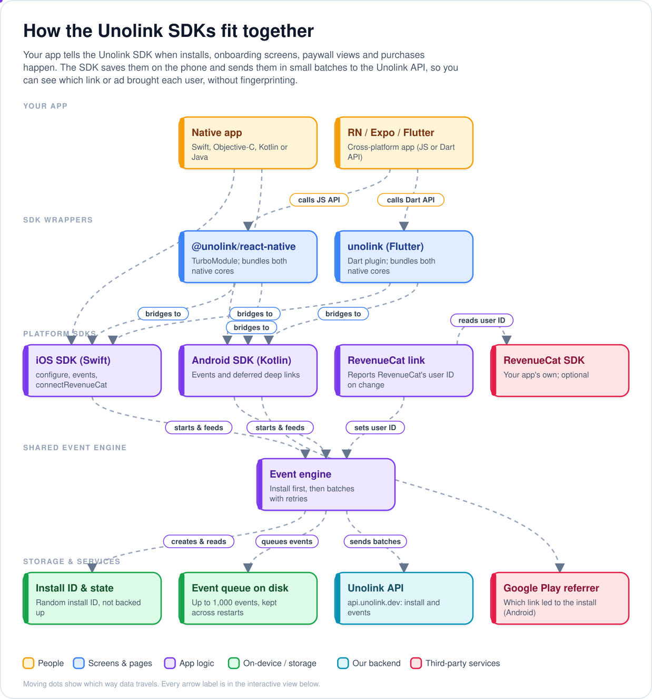
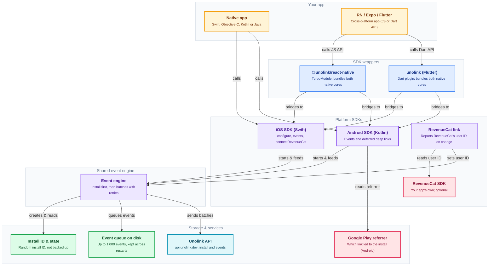

# Unolink SDKs

Open-source SDKs for [Unolink](https://unolink.dev): see which link or ad brings installs, onboarding, paywall
views, trials and purchases, and send people who install from a link straight to the right screen.

| Platform | Status | Install |
|---|---|---|
| Android (Kotlin, Java) | 0.3.3, beta | Maven Central: `dev.unolink:unolink:0.3.3` |
| iOS (Swift, Objective-C) | 0.3.3, beta | Swift Package Manager: `https://github.com/unolink-dev/unolink-sdk` |
| React Native / Expo | 0.3.3, beta | npm: `@unolink/react-native` |
| Flutter | 0.3.3, beta | pub.dev: `unolink` |

Install notes (React Native, Expo, Flutter):

- **CocoaPods needs a UTF-8 locale.** With Ruby 4, or a shell without a UTF-8 locale, `pod install` fails with an
  encoding error: run `LANG=en_US.UTF-8 pod install` (or `export LANG=en_US.UTF-8` before `npx expo prebuild`,
  `npx expo run:ios` or `flutter build ios`).
- **Don't use `npm install --legacy-peer-deps`.** It rewrites `package-lock.json` and drops optional peer dependencies.
  Use `npx expo install @unolink/react-native` (Expo) or a plain `npm install`.

Deferred deep links (Android) stay pending on the device until the app calls `consumeDeferredDeepLink()` (30 days at
most), so a new user who quits mid-onboarding still gets theirs on the next launch. See each SDK's README.

<!-- architecture:start (generated by ~/Desktop/Usefull scripts/readme-architecture-diagrams: edit specs.mjs there and run node run.mjs, not this block) -->
## How it works

Your app tells the Unolink SDK when installs, onboarding screens, paywall views and purchases happen. The SDK saves them on the phone and sends them in small batches to the Unolink API, so you can see which link or ad brought each user, without fingerprinting.

<p align="center"></p>

<details>
<summary><b>Interactive view</b> (zoom and pan on GitHub)</summary>



</details>

### Main journeys

**First launch reports an install**

1. The app calls configure with its SDK key (starts with ulk_).
2. The SDK creates a random install ID and saves it in the app's own storage, excluded from backup.
3. It queues first_open and session_start events.
4. On Android it waits up to 10 seconds for Google Play's install referrer. iPhone skips this step.
5. It sends the install to the Unolink API with the app, OS and SDK versions, phone or tablet, and language.
6. If sending fails, it retries with backoff, and other events wait until the install is registered.

**Tracking a paywall view**

1. The app calls paywallViewed with a placement such as "onboarding".
2. The event goes into the queue on disk, so it survives an app restart.
3. Queued events are sent in batches: when 20 are waiting, every 15 seconds in the foreground, and when the app goes to the background.
4. Once the API accepts a batch, it's removed from the queue.

**A purchase via RevenueCat**

1. The app calls connectRevenueCat with a function that returns RevenueCat's app user ID.
2. The SDK reads that ID at configure, when the app comes to the foreground, and before each event.
3. It sends the ID only when it changes, attached to the install.
4. Unolink can then join RevenueCat purchases, renewals and refunds to the link the install came from.

**Android deep link after install**

1. Someone taps a Unolink link and installs the app from Google Play.
2. On first launch the Android SDK reads the Google Play install referrer.
3. The link is saved on the device and delivered once to the app's deferred deep link listener.
4. The app opens the right screen and calls consumeDeferredDeepLink. Until then, the link is kept for up to 30 days.
5. On iPhone the app is never told which link was tapped.

### Where things live

| Part | Path | What it does |
| --- | --- | --- |
| iOS SDK entry point | `ios/Sources/Unolink/Unolink.swift` | The public Swift and Objective-C API: configure, the event calls, connectRevenueCat and installId. |
| iOS engine | `ios/Sources/Unolink/Internal/Engine.swift` | Registers the install, then queues, batches and retries events on one background queue. |
| iOS platform layer | `ios/Sources/Unolink/Internal/Platform.swift` | Files in Application Support (excluded from backup), HTTP requests, app foreground and background. |
| Android SDK entry point | `android/unolink/src/main/java/dev/unolink/Unolink.kt` | The public Kotlin and Java API, including the deferred deep link calls. |
| Android engine | `android/unolink/src/main/java/dev/unolink/internal/Engine.kt` | Install registration, the event queue, batching, backoff and the pending deep link. |
| Android platform layer | `android/unolink/src/main/java/dev/unolink/internal/AndroidPlatform.kt` | Files in the no-backup folder, HTTP calls and the Google Play install referrer. |
| RevenueCat link | `android/unolink/src/main/java/dev/unolink/internal/RevenueCatLink.kt` | Reads RevenueCat's app user ID and reports it only when it changes (iOS has a matching file). |
| React Native package | `react-native/src/index.ts` | The JS/TS API for React Native and Expo; holds calls made before configure. |
| React Native native modules | `react-native/src/NativeRNUnolink.ts` | The TurboModule spec, implemented in react-native/ios and react-native/android. |
| Flutter package | `flutter/lib/unolink.dart` | The Dart API, calling the native plugin over a MethodChannel. |
| Native core sync | `flutter/tool/sync_native.sh` | Copies the iOS and Android cores into the Flutter plugin (react-native/scripts/sync-native.mjs does the same for React Native). |
| API contract | `contract/openapi.yaml` | The shared spec for install and events, plus the schemas and scenarios every SDK is tested against. |

**Built with:** Version 0.3.3 (beta), MIT licence, iOS: Swift 5.9, Swift Package Manager, iOS 13+, no dependencies, privacy manifest, Android: Kotlin 2.1, minSdk 23, Maven Central (dev.unolink:unolink), Google Play Install Referrer, React Native: @unolink/react-native on npm, RN 0.79+, TurboModule, Expo dev builds (not Expo Go), Flutter: unolink on pub.dev, Dart 3.4+, Flutter 3.22+

### Links

- Unolink: https://unolink.dev
- SDK docs: https://unolink.dev/docs/sdk
- All SDK docs in one file for AI coding assistants: https://unolink.dev/llms.txt
<!-- architecture:end -->

## What the SDK collects

- A **random install ID**, created on first launch and stored only in your app's own storage. A reinstall gets a new
  one. It is never linked to a person, an advertising ID or the device.
- App version, OS version, SDK version, phone or tablet, language.
- The events you send (`onboardingStep`, `onboardingCompleted`, `paywallViewed`, `trialStarted`, `purchase`, your own) with the
  properties you choose, plus three automatic ones: first open, session start, app to background.
- On Android, the Google Play install referrer, which says which Unolink link someone installed from.

It does **not** collect the IDFA or Google Advertising ID, never shows the App Tracking Transparency prompt, and never
fingerprints devices. Country comes from Cloudflare at the edge; IP addresses are not stored.

## Repository layout

```
contract/   The SDK API contract: plain-language spec, OpenAPI, JSON Schemas, test scenarios
android/    Android SDK (Kotlin) + Kotlin and Java sample apps
ios/        iOS SDK (Swift) + SwiftUI and Objective-C samples
react-native/  React Native / Expo bridge (@unolink/react-native)
flutter/    Flutter plugin (unolink) + example app
```

Docs: <https://unolink.dev/docs>. Licence: MIT.
